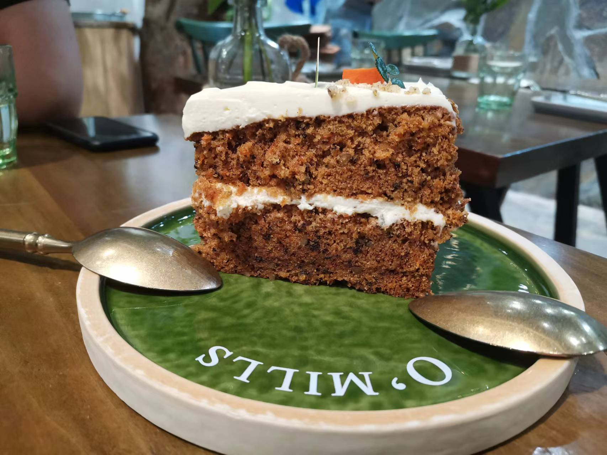
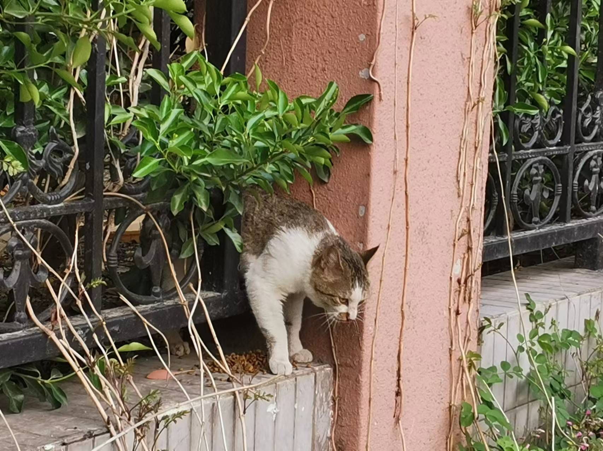

I am a Ph.D. student in Computer Science and Technology at [ShanghaiTech University](https://www.shanghaitech.edu.cn/eng/), where I work with Prof. [Dengji Zhao](http://dengji-zhao.net) at [SMART Lab](https://smart.sist.shanghaitech.edu.cn). Since June 2024 I have also been a research intern at the [Beijing Institute for General Artificial Intelligence (BIGAI)](https://www.bigai.ai/), advised by [Xue Feng](https://scholar.google.com/citations?hl=zh-CN&user=KAQ5JlYAAAAJ) and Zhenliang Zhang.

My research sits where reinforcement learning, game theory, and mechanism design meet. I am drawn to autonomous decision-making and incentive design in multi-agent systems: how agents learn, adapt, and coordinate in partially observable, mixed-motive environments, and how well-designed rules can make cooperation, stable matching, and other desirable outcomes emerge rather than collapse. Lately I have been working on reputation and social norms in multi-agent learning, and on whether embodied agents built on multimodal LLMs proactively respect unspoken social norms. I am also curious about continual learning and goal generation, and about how they can make LLM agents more capable over time.

Research Interests
------
- **Multi-agent reinforcement learning.** Cooperation, reputation, social norms, and emergent behavior in decentralized multi-agent systems.
- **Mechanism design on social networks.** Matching, incentive compatibility, stability and optimality when agents can invite or exclude one another.
- **LLM and embodied agents.** Social-norm compliance, benchmark and task design, supervised fine-tuning, and agent evaluation.
- **Continual learning and goal generation.** Agents that keep learning, and that can set and revise their own goals.

Selected Publications
------
A full list, with DOI and arXiv links, is on the [publications page](/publications/).

- **Learning to Adapt through Reviews in Online Markets** · *WWW 2027 (under review)* — Buyers learn when to purchase and how to review, sellers learn how to disclose information; when both sides see the reviews, a forward-looking algorithm keeps the market from collapsing, raising the average trade rate from 2% to 29.7%.
- **Learning to Cooperate with Emergent Reputation via Multi-agent Reinforcement Learning** · *AAAI 2027 (under review)* · [arXiv](https://arxiv.org/abs/2606.04359) — COOPER jointly learns reputation assessment, gossip, and policies from environment rewards alone, so cooperation and reputation norms co-emerge in self-play and adapt to new co-players.
- **NormAct: Benchmarking Embodied Agents' Proactive Compliance with Unspoken Social Norms** · *ARR October 2026 (under review)* · [arXiv](https://arxiv.org/abs/2606.27826) — 550 TongSim scenarios in which the same goal admits either compliant or violating behavior; strong MLLM planners reach 67.4% task success but only 24.7% norm compliance without guidance.
- **Stable Marriage on Networks** · *AAMAS 2026* · [DOI](https://doi.org/10.65109/pkvj4128) — Stable two-sided matching on social networks, where agents are truthful about their preferences and both sides have incentives to invite others into the game.
- **Housing Market on Networks** · *AAMAS 2025* · [DOI](https://doi.org/10.65109/dvvr5292) · [arXiv](https://arxiv.org/abs/2303.09759) — New notions of stability and optimality for one-sided matching on networks, and Connected Trading Cycles, the first mechanism to achieve the best of both together with incentive compatibility.
- **Truthful and Stable One-sided Matching on Networks** · *AAMAS 2024 (extended abstract)* · [DOI](https://doi.org/10.65109/pekx6502) · [arXiv](https://arxiv.org/abs/2201.05787) — Swap With Neighbors and Leave and Share: incentive-compatible mechanisms for diffusion one-sided matching on arbitrary networks, attaining the tightest stability that incentive compatibility allows.

Education
------
- **Ph.D. in Computer Science and Technology**, ShanghaiTech University & BIGAI Joint Program, 2024.09–2027.06 (expected)
- **M.S. in Computer Science and Technology**, ShanghaiTech University, 2021.09–2024.06
- **B.Eng. in Software Engineering**, Beihang University & Beijing University of Technology Joint Program, 2017.09–2021.06

Teaching & Service
------
- Teaching assistant: Machine Learning (2022, 2025), Python Programming (2023), Algorithmic Game Theory (2021).
- Reviewer for AAMAS, NeurIPS, ICML, and for journals including JAAMAS and IEEE TCSS (2024–present).
- Hotel and banquet organization for WINE 2023 and DAI 2021.
- Selected participant, 2026 Reinforcement Learning Summer School with Richard S. Sutton (Shanghai Innovation Institute).

Personal Interests
------
* Go hiking/cycling in sunny days, and spy on cute animals :)
* Latin Dancing!!
* Enjoy Cantonese food, Dairy Queen, and special flavored coffee with Frank ~

Photos
------
<figure class="third">
  
</figure>

<figure class="third">
  
</figure>
